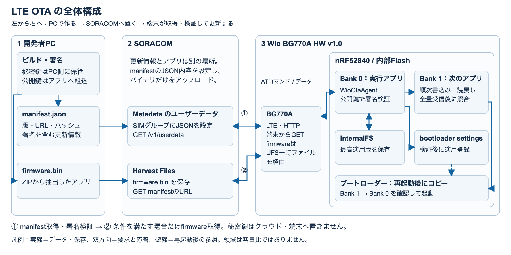
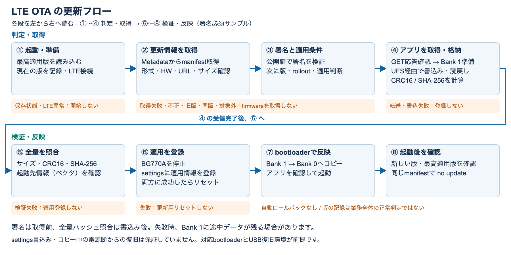

# LTE経由でWio BG770Aのアプリケーションを更新する

Wio BG770Aに最初のアプリをUSBで導入し、次の版をLTE経由で受け取って更新します。
SORACOM Metadataに置いた更新情報（manifest）と、Harvest Filesに置いたアプリのバイナリを使います。
署名とイメージを検証した後に再起動し、版が変わったことをシリアルモニタで確認します。

このレシピは **新規の検証用Wio BG770A HW v1.0を1台、版1から版2へ更新する** 手順です。
起動できないアプリからの自動ロールバックはありません。USBで復旧できる環境で進めてください。
稼働済み端末では保存データ・現在の版・最高適用版・鍵を引き継ぐ必要があり、初期化や版1の導入をそのまま適用できません。

既存のPM2.5レシピと[Seeed公式ユーザーマニュアル](https://seeedjp.github.io/Wiki/Wio_BG770A/user-manual.html)に合わせ、Arduino IDEを主経路にしています。
CLIとPlatformIOを使う場合のビルド・初回書込みは[別経路の手順](docs/build-alternatives.md)にまとめました。
どちらでもハード・SIM・ブートローダー・保存領域・鍵の準備と、配信・確認の手順は共通です。

**この文書の再編集後、実機で最初から通した検証は未実施です。**
ホスト上のビルド・テストと元PRの過去の実機結果は[出典・検証履歴](docs/validation.md)で区別しています。
画面やログを今回の実測として掲載していません。

## 完成するものと全体構成

完成するのは、**起動時に自分の更新を確認できるアプリ**です。最初に版1をUSBで導入した後は、
PCで版2の配信ファイルを作り、端末がLTEで取得して更新します。クラウド側が端末へ書き込む仕組みではなく、端末からのHTTP GETで始まります。



[SVGで拡大](docs/diagrams/architecture.svg)・[図の編集と再生成](docs/diagrams/README.md)

凡例：実線はデータの受渡し・保存、破線は制御の参照です。双方向の線は要求と応答を表し、HTTP GETは端末側から送ります。Flashの箱は役割を表し、アドレス順や容量比ではありません。

**開発者**がビルド・署名と配信設定を行い、**BG770A**が通信、**MCUのアプリ**が更新判定と検証、**ブートローダー**が再起動後の反映を担当します。
秘密鍵はアップロードせず、端末はアプリ内の公開鍵でmanifestを検証します。署名不一致・旧版・配信対象外ならfirmwareを取得しません。
Metadataは端末が所属するSIMグループの設定です。`manifest.json` というファイルをHarvest Filesへ置くのではなく、JSONの内容をユーザーデータへ設定します。
具体的な配置は[配信手順](#publish-update)、鍵の用意は[署名鍵の準備](#signing-key)へ進んでください。

### ファイルと設定の置き場所

| ファイル・設定 | PC側 | 配信先・端末側での役割 |
|---|---|---|
| 秘密鍵 | リポジトリ外の `signing-key.pem` | PC側で署名にだけ使用。端末・クラウドへ置かない |
| 公開鍵 | `examples/CellularStatusOta/ota_manifest_public_key.h` | アプリへ組み込まれ、manifestの署名を検証 |
| アプリの版 | `ota_sketch_config.h` の `APP_VERSION`（CLI/PlatformIOはビルド設定） | 実行中の版。manifestの版と一致させてビルド・配信 |
| 更新アプリ本体 | `dist/sample-update/firmware.bin` | Harvest Filesの `/wio-bg770a/sample-update/firmware.bin`。取得URLは `http://harvest-files.soracom.io/wio-bg770a/sample-update/firmware.bin` |
| 更新情報 | `dist/sample-update/manifest.json` | 検証専用SIMグループのMetadataユーザーデータ。端末は `http://metadata.soracom.io/v1/userdata` で取得 |
| 版の保存記録 | PCから配布しない | MCUのInternalFS内の2つのレコード。最高適用版を通常RESET後も保持 |
| 適用登録 | PCから配布しない | MCUのbootloader settings。アプリが検証済みイメージの適用を登録し、bootloaderが読む |

InternalFSは、電源を切っても残る小さなファイル保存領域です。ここでは「どの版まで適用したか」を記憶し、再起動後に古い版を受け入れないために使います。
firmwareのダウンロード先であるBG770AのUFSや、更新イメージを置くMCUのBank 1とは別です。
保存記録が読めないとOTAを止めます。初回準備も含め、[InternalFSの手順](docs/internalfs.md)を参照してください。

### 更新はこの順に進む

次の図は、このレシピの署名必須サンプルで新しい版を適用する経路です。下段の反映は[対応bootloaderを確認済み](docs/bootloader.md)であることが前提です。



[SVGで拡大](docs/diagrams/update-flow.svg)・[図の編集と再生成](docs/diagrams/README.md)

読み方：上段①〜④、下段⑤〜⑧をそれぞれ左から右へ進みます。青い矢印は成功時の処理順序、橙色の注記は失敗時に実行しない処理です。転送・書込み中の失敗は全量検証へ進まず終了します。

**アプリ**はfirmwareを取得する前にmanifestの署名を検証し、署名で保護されたSHA-256と取得データを全量受信後に照合します。
書込みと全量検証はこの順なので、未検証データも一時的にBank 1へ入りますが、検証失敗なら適用登録しません。
`discard()` は処理状態を戻すだけで、書込み済み領域を消去する処理ではありません。
全量検証後もモデム停止とsettings登録に成功して初めて更新用リセットを行います。settings書込みやbootloaderコピー中の電源断からの復旧は保証していません。

**ブートローダー**はBank 1からBank 0へコピーします。2つの領域から起動先を選んで旧版へ戻す仕組みではなく、自動ロールバックはありません。
起動後の版記録はアプリの `setup()` 到達を示し、業務処理全体の正常性を保証するヘルスチェックではありません。
署名検証はアプリ側の機能であり、HTTPの暗号化やbootloader secure bootではありません。
実際の確認は[更新と成功確認](#publish-update)、失敗時は[切り分け](#troubleshooting)へ進みます。

### 初回USB準備と以後のLTE更新

| | 初回：PCとUSBで準備 | 以後：LTEでアプリを更新 |
|---|---|---|
| 基盤 | 対応bootloaderを確認し、必要な場合だけ移行。新規端末のInternalFSを確認・準備 | このレシピのOTAはbootloader・SoftDeviceを更新しない。InternalFSを初期化しない |
| アプリ・鍵 | OTA処理と公開鍵を組み込んだ版1をUSB導入 | 同じOTA処理・鍵の扱いを保った新しい版を取得。秘密鍵は引き続きPC側 |
| 更新の開始 | USB書込み後にアプリを起動 | manifest公開後、アプリの次の起動時に取得。公開だけでは端末を起こせない |
| 確認 | 版1、LTE接続、保存記録の正常性 | 新しい版・最高適用版・同じmanifestに対する `no update` を確認 |

最初は[必要なもの](#requirements)から順に進め、USB導入済みなら[更新用ファイルの生成](#update-image)へ進みます。
版を上げるたびにInternalFSを消したり、版1をUSBで書き戻したりする必要はありません。

<details>
<summary>図と照合したコード</summary>

- [通常スケッチ](examples/CellularStatusOta/CellularStatusOta.ino)：Metadataのhost/path、許可するfirmwareホスト、署名・版・rolloutの設定、起動時の版記録。
- [Agent](src/WioOtaAgent.cpp)：manifest取得・判定・firmware取得・検証・モデム停止・適用登録・resetの順序。
- [署名と版の判定](src/WioOtaSecurity.cpp) / [manifest形式](src/WioOtaManifest.cpp)：署名検証後に版・配信対象を確認。
- [HTTP/UFS転送](src/WioBg770aHttp.h)、[Flash書込み](src/WioOta.cpp)、[全量検証](src/WioOtaImageVerifier.cpp)、[版の保存](src/WioOtaVersionStore.cpp)。
- [配信ツール](tools/firmware_manifest.py)：application抽出、ハッシュを含むmanifestの署名。
- 対象bootloaderリビジョン `3cb5c65` の [起動処理](https://github.com/SeeedJP/Adafruit_nRF52_Bootloader/blob/3cb5c653e3c5390a4fa05fc3ad7219b8e73086e4/src/main.c) と [Bank 1からのコピー処理](https://github.com/SeeedJP/Adafruit_nRF52_Bootloader/blob/3cb5c653e3c5390a4fa05fc3ad7219b8e73086e4/lib/sdk11/components/libraries/bootloader_dfu/dfu_dual_bank.c)。実機の導入イメージは[識別子・配布ZIPの確認手順](docs/bootloader.md)で別途確認します。

</details>

<a id="requirements"></a>
## 1. 必要なもの

| 必要なもの | 条件・用途 |
|---|---|
| Wio BG770AとLTEアンテナ | HW v1.0を1台。HW v1.1は対象外 |
| USB-CデータケーブルとPC | 安定した給電、初回書込み、シリアルモニタ |
| 登録済みSORACOM IoT SIM | 使用場所のLTE-Mで接続でき、MetadataとHarvest Filesを利用できるもの |
| SORACOMアカウント | SIMグループの設定とHarvest Filesのアップロード権限 |
| Arduino IDEとボードパッケージ | SeeedJP nRF52 Boards **1.5.1**、S140 **7.3.0** |
| Arduinoライブラリ | WioCellular **0.3.15**、ArduinoJson **7.0.4** |
| PCのコマンド環境 | Git、Python 3（venv使用可）、`cryptography`、Ed25519対応OpenSSL。以下のコマンドはmacOS/Linuxのbash/zsh向け |

作業時間は開発環境の有無、ブートローダーの状態、電波状況で変わります。
SIMの契約・通信とHarvest Filesに料金が発生します。料金・利用条件を確認してから有効化してください。
WioOtaAgentのアプリ上限は **397,312 bytes** です。TinyUSB、InternalFS、Adafruit nRFCryptoはCore同梱版を使います。

## 2. ハードウェアとSIMを準備する

1. 電源を外し、基板がHW v1.0であることを確認します。
2. [ユーザーマニュアルの「LTEアンテナとSIMを取り付ける」](https://seeedjp.github.io/Wiki/Wio_BG770A/user-manual.html)に従い、LTE端子へアンテナ、SIMスロットへSIMを取り付けます。
3. SORACOMユーザーコンソールで検証専用のSIMグループを作り、この1台のSIMだけを所属させます。SIMが利用開始済みで、通信を許可する状態か確認します。
4. [メタデータサービス](https://users.soracom.io/ja-jp/docs/air/use-metadata/)を有効にし、読み取り専用（Read-only）を有効にします。既存の配信を引き継がない新規グループを使い、ユーザーデータはまだ空のままにします。
5. [Harvest Filesを有効化](https://users.soracom.io/ja-jp/docs/harvest/enable-files/)し、このSIMからのダウンロードを許可する設定にします。

サンプルのAPNは `soracom.io` です。firmwareの取得先は `harvest-files.soracom.io` のHTTP・ポート80だけを許可し、manifestは `http://metadata.soracom.io/v1/userdata` から取得します。
PCの通常のインターネット回線からこれらの端末向けURLへアクセスする手順ではありません。
このサンプルは起動時に1回だけ更新を確認し、条件を満たす更新を自動適用します。初回起動前に対象SIMとグループを再確認してください。

<a id="software"></a>
## 3. PCの開発環境とソースを準備する

1. [Seeed公式の開発環境セットアップ](https://seeedjp.github.io/Wiki/Wio_BG770A/user-manual.html)に従ってArduino IDEを導入します。追加のボードマネージャURLに `https://www.seeed.co.jp/package_SeeedJP_index.json` を追加し（既存URLは残します）、SeeedJP nRF52 Boards **1.5.1** を選びます。
2. ライブラリマネージャでWioCellular **0.3.15**、ArduinoJson **7.0.4** を導入します。
3. ターミナルで次を実行します。以後、特記のないコマンドは `app-ota` ディレクトリから実行します。

```bash
git clone https://github.com/SeeedJP/wio_bg770a_recipes.git
cd wio_bg770a_recipes/app-ota
python3 -m venv .venv
.venv/bin/python -m pip install cryptography
.venv/bin/python tools/package_arduino_library.py
```

PRのマージ前に試す場合は、上のclone/cdの代わりに次を使い、その後にvenv作成とZIP生成を行います。

```bash
git clone --branch feat/lte-ota-recipe https://github.com/takao2704/wio_bg770a_recipes.git
cd wio_bg770a_recipes/app-ota
```

4. Arduino IDEの「スケッチ」→「ライブラリをインクルード」→「.ZIP形式のライブラリをインストール」で `dist/arduino/WioOtaAgent.zip` を選びます。リポジトリ全体のZIPではありません。旧構成の `WioOta`、`WioBg770aHttp`、`WioOtaAgent` があれば保存場所を控えてバックアップし、同名ヘッダを持つ旧ライブラリと併用しないよう整理します。
5. PCとWioを接続し、以下のボード設定を選びます。以降の準備用スケッチにも同じ設定を使います。

| ツールメニュー | 設定 |
|---|---|
| ボード | Wio BG770A |
| Board Version | 1.0 |
| SoftDevice | S140 7.3.0 |
| Print Port | Serial (USB-CDC) |
| ポート | 接続したWioのポート |

<a id="prepare-device"></a>
## 4. ブートローダーと保存領域を確認する

PCのボードパッケージを導入しただけでは、実機のブートローダーは更新されません。

1. [ブートローダーの確認・必要な場合の移行](docs/bootloader.md)を実施し、対応するdual-bank版とS140 7.3.0を確認します。識別子が不明な場合は先へ進みません。
2. [InternalFSの確認・新規端末の初回準備](docs/internalfs.md)を実施します。まず消去しないマウント確認を行い、未初期化と判断できる新規端末だけを明示的に準備します。**マウント失敗は、消してよい証拠にはなりません。**
3. マウント成功を確認したら次へ進みます。OTAサンプルに自動フォーマット処理を追加しないでください。

初回USB導入は既存アプリを置き換えます。保存すべきアプリやデータがある場合は復旧方法を先に用意します。

<a id="signing-key"></a>
## 5. 署名鍵と公開鍵ヘッダを用意する

両ビルド環境で署名検証は必須です。新規検証用の鍵をリポジトリの外に作り、初回と次回更新で同じ鍵・key IDを使います。
既存の運用鍵がある端末では鍵を新規生成せず、管理された署名環境で既存の鍵を使います。

```bash
ota_key_dir="$(mktemp -d "$HOME/wio-ota-keys.XXXXXX")"
openssl genpkey -algorithm ED25519 -out "$ota_key_dir/signing-key.pem"
chmod 600 "$ota_key_dir/signing-key.pem"
openssl pkey -in "$ota_key_dir/signing-key.pem" -pubout \
  -out "$ota_key_dir/public-key.pem"
.venv/bin/python tools/export_manifest_public_key.py "$ota_key_dir/public-key.pem" \
  --key-id demo-key \
  --output examples/CellularStatusOta/ota_manifest_public_key.h
```

`ota_key_dir` の実際の保存先を控えてください。別のターミナルではこの変数にその保存先を再設定します。
秘密鍵はスケッチ・端末・Harvest Files・Gitへ置きません。本番鍵はアクセス制御した署名環境で管理します。
`ota_manifest_public_key.h.example` をリネームするだけでは使えません。生成した公開鍵ヘッダが必要です。

<a id="first-app"></a>
## 6. 版1をUSBで導入する

1. Arduino IDEでリポジトリ内の [CellularStatusOta.ino](examples/CellularStatusOta/CellularStatusOta.ino) を開きます。今回はライブラリのスケッチ例を別フォルダへコピーせず、このファイルを使います。
2. 同じフォルダに生成した `ota_manifest_public_key.h` があり、[ota_sketch_config.h](examples/CellularStatusOta/ota_sketch_config.h) が `APP_VERSION=1`、`WIO_OTA_ARDUINO_SECURE=1` であることを確認します。
3. 手順3のボード設定で「検証・コンパイル」を実行し、成功したら「書き込み」を実行します。ポートが見つからない場合はRESETをダブルクリックしてDFUポートを選び直します。ここでは「ブートローダを書き込む」は使いません。
4. シリアルモニタを115200 bpsで開き、必要ならRESETを1回押します。`app-version=1`、`[LTE] network ready`、`current=1 highest=1` を確認します。

ユーザーデータをまだ空にしているため、この段階でmanifest取得・解析が失敗し `result=failed` になることは想定内です。
`security state unavailable` やLTE接続失敗は想定内ではありません。[切り分け](#troubleshooting)を確認し、解決してから配信します。
版1が動作したら、版2をUSBで書き込むことなく次へ進みます。

<a id="update-image"></a>
## 7. 版2と署名付き配信ファイルを作る

1. `ota_sketch_config.h` の `APP_VERSION` を **2** へ変更して保存します。鍵と `WIO_OTA_ARDUINO_SECURE=1` は保持します。
2. 「スケッチ」→「コンパイル済みのバイナリをエクスポート」を実行します。「書き込み」は押しません。
3. 次の application DFU ZIP が生成されたことを確認します。IDEの版によって出力先が異なる場合は、コンパイル出力で実際のZIPを確認して入力パスを合わせます。

```text
examples/CellularStatusOta/build/SeeedJP.nrf52.wio_bg770a/CellularStatusOta.ino.zip
```

4. `app-ota` ディレクトリで署名付きmanifestとapplication raw binaryを生成します。CLI・PlatformIOの場合は[別経路](docs/build-alternatives.md)のZIPを入力にします。

```bash
.venv/bin/python tools/firmware_manifest.py \
  examples/CellularStatusOta/build/SeeedJP.nrf52.wio_bg770a/CellularStatusOta.ino.zip \
  --version 2 \
  --url http://harvest-files.soracom.io/wio-bg770a/sample-update/firmware.bin \
  --signing-key "$ota_key_dir/signing-key.pem" \
  --key-id demo-key --release-id sample-update --rollout 10000 \
  --output dist/sample-update/manifest.json \
  --firmware-output dist/sample-update/firmware.bin
```

入力はapplication-only DFU ZIPかapplication raw binaryです。HEX、ELF、SoftDevice・bootloaderを含むZIPは拒否します。
`--version` はビルドした `APP_VERSION` と一致させます（ツールはアプリから版番号を読み取りません）。
`rollout=10000` は全対象端末です。このレシピでは検証用グループの1台だけを対象にします。
URL・version・rolloutなどを変更するときは、JSONの手編集ではなく再生成・再署名します。
次のリリースでは `sample-update` を新しい識別子・パスへ変更し、公開済みバイナリを上書きしません。

<a id="publish-update"></a>
## 8. 配信してLTEで版を更新する

1. SIMと同じカバレッジのSORACOMユーザーコンソールで [Harvest Filesへアップロード](https://users.soracom.io/ja-jp/docs/harvest/send-files/)します。ローカルの `dist/sample-update/firmware.bin` の保存先を **`/wio-bg770a/sample-update/firmware.bin`** にします。ディレクトリとファイル名がmanifestのURLのパスと一致することを確認します。
2. アップロード済みファイルを[コンソールからダウンロード](https://users.soracom.io/ja-jp/docs/harvest/files-download/)して別名で保存し、元ファイルとバイト数・SHA-256を照合します。例えば同じ作業ディレクトリの `dist/sample-update/downloaded-firmware.bin` に保存した場合、次を実行します。不一致ならmanifestを公開しません。

```bash
.venv/bin/python - <<'PY'
import hashlib
from pathlib import Path
original = Path('dist/sample-update/firmware.bin').read_bytes()
downloaded = Path('dist/sample-update/downloaded-firmware.bin').read_bytes()
assert original == downloaded, 'uploaded firmware differs'
print('bytes:', len(original), 'sha256:', hashlib.sha256(original).hexdigest())
PY
```

3. 対象グループのメタデータサービスの「ユーザーデータ」に、`dist/sample-update/manifest.json` の **JSON内容全体** を貼り付けて保存します。JSONを引用符で囲んだ文字列やファイル名にはしません。Read-onlyは有効のままにします。
4. 版1のWioのシリアルモニタを開き、RESETを **1回** 押します（ダブルクリックのDFUではありません）。更新取得・適用中は安定した給電・通信を保ちます。
5. 進捗、`[OTA] image verified`、`[OTA] activated; rebooting` を確認します。USBが再接続されたらモニタを開き直し、`app-version=2` を確認します。
6. 同じmanifestに対する `[OTA] result=no update` を確認します。さらに更新処理が終わった状態で通常RESETし、`loaded=2 current=2 highest=2` と `no update` が維持され、firmwareを再取得しないことを確認します。

以下は **コードの出力形式に合わせた説明用の抜粋** です。今回取得した実測ログではありません。初回更新直後の `loaded` は、再起動前に保存されていた版なので1になり得ます。

```text
[OTA] image verified
[OTA] activated; rebooting
cellular-status + OTA, app-version=2
...
[OTA] security state loaded=1 current=2 highest=2
...
[OTA] result=no update
```

manifestの保存は端末へのプッシュ通知ではありません。このサンプルは起動時に1回だけ確認し、確認後は5秒ごとに `[APP] version=...` を出します。

<a id="troubleshooting"></a>
## 9. 確認と切り分け

| 症状 | 確認すること・次の操作 |
|---|---|
| 公開鍵ヘッダがなくビルド失敗 | 手順5の出力先が、IDEで開いているスケッチと同じフォルダか確認 |
| `security state unavailable: internal filesystem mount failed` | [保存領域の手順](docs/internalfs.md)へ戻る。マウント失敗だけで新規と決めず、稼働済み・履歴不明の端末は消去せず調査 |
| `no valid version record; explicit recovery required` | 保存記録が読めない状態。記録を消して旧版を通さず、既知の適用版とデータを確認して復旧 |
| `[LTE] modem power-on failed` / `network attach failed` | 電源、アンテナ、SIM、利用状態・電波状況を確認。書込み・適用中でないことを確認してから再試行 |
| manifest取得・解析に失敗 | 初回の空データなら手順7へ。公開後ならSIMの所属グループ、Metadata有効化、JSON内容とHTTP応答を確認 |
| 署名・版・配信条件の拒否 | 公開鍵と署名鍵、key ID、`APP_VERSION`とmanifest版、最高適用版、対象HW、rolloutを確認。署名無効化・履歴消去で回避しない |
| firmware取得に失敗 | Harvest Filesのカバレッジ・有効化・読出し権限、URLと保存パス、HTTPステータスを確認。HTTPS、chunked transfer、途中再開は非対応 |
| HTTP/UFS失敗後に接続できない | 本体RESETだけではモデム状態が残る場合がある。処理が失敗して終了したログを確認し、適用中でない状態でUSB電源を入れ直して再試行。[回復処理の詳細](docs/integration.md)を参照 |
| 再起動後も版1 / USBが復帰しない | bootloader、対象HW、配信したZIPと版を確認。繰り返し配信せずログを保存し、[bootloaderの復旧条件](docs/bootloader.md)を確認 |

HTTPの署名は真正性・完全性を検証しますが、通信内容は暗号化しません。bootloader secure bootでもありません。
日次スケジューラ、遠隔完了通知、端末群の管理、起動不能時の自動ロールバックは含みません。

[API統合・HTTP復旧・制約](docs/integration.md) / [出典・過去の検証履歴と今回の検証範囲](docs/validation.md)
